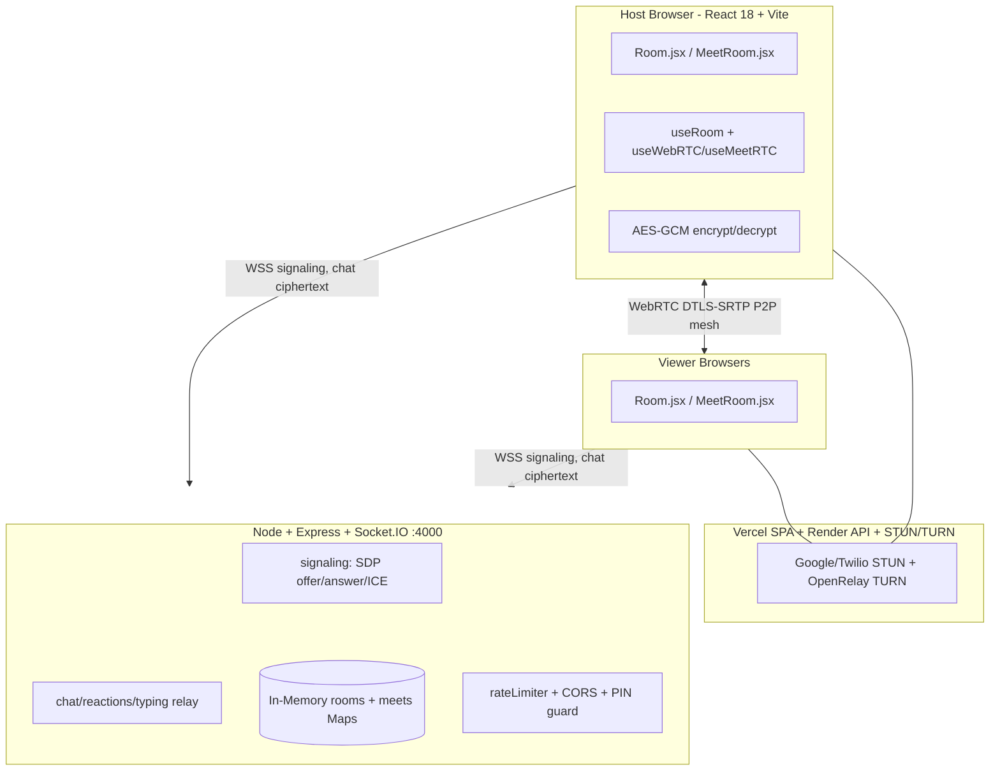
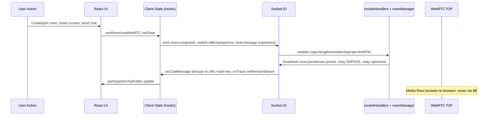

# ScreenLoop — Master Engineering, Architecture & Product Audit Plan

> Status: **Phase 2 EXECUTED — awaiting review**. Phases 0–1 verified.
> Stack: React 18 + Vite | Node + Express + Socket.IO | WebRTC Mesh | AES-256-GCM E2EE
> Repo: `I:\Web devlopment\Screenshare`

Please approve (or request changes) before Phase 1 execution.

---

## Table of Contents

- [A. Executive Summary](#a-executive-summary)
- [B. Current Architecture](#b-current-architecture-verified-against-code)
- [C. Architecture Diagram](#c-architecture-diagram)
- [D. Data Flow Diagram](#d-data-flow-diagram)
- [E. Bug Report](#e-bug-report)
- [F. Dead Code Report](#f-dead-code-report)
- [G. Security Audit](#g-security-audit)
- [H. Performance Audit](#h-performance-audit)
- [I. UI/UX Audit](#i-uiux-audit)
- [J. API Audit](#j-api-audit)
- [K. Database/Data Audit](#k-databasedata-audit)
- [L. Testing Strategy](#l-testing-strategy)
- [M. CI/CD Audit](#m-cicd-audit)
- [N. Observability Strategy](#n-observability-strategy)
- [O. Screen Sharing / Realtime Architecture](#o-screen-sharing--realtime-architecture-discordmeetzoom-grade-without-copying)
- [P. Future Architecture](#p-future-architecture)
- [Q. Master Implementation Roadmap](#q-master-implementation-roadmap)
- [R. Risk Register](#r-risk-register)
- [S. Definition of Done](#s-definition-of-done)
- [T. Professional README Plan](#t-professional-readme-plan)
- [Phase 0 Baseline Results](#phase-0-baseline-results)
- [Approval Checklist](#approval-checklist)

---

## A. Executive Summary

**What it is:** ScreenLoop — zero-friction P2P watch-party (`/room/:roomId`, 1-to-many screen share) + Google Meet-style video meet (`/meet/:meetId`, multi-party webcam). React 18 + Vite SPA + Node/Express + Socket.IO signaling server. No DB. Ephemeral in-memory rooms. WebRTC mesh. AES-256-GCM E2EE chat (watch rooms only).

**Overall state:** Working, well-documented, security-conscious prototype. `PLAN.md` claims 109/109 tasks complete, 67 tests passing. Architecture docs (`ARCHITECTURE.md`, `README.md`) are largely accurate but drift from code in 3 places (E2EE short-message rule, meet E2EE claim, test counts).

**Biggest risks:**

1. **P0: `/meet` multi-party calling is broken by design** — `client/src/pages/MeetRoom.jsx:42` passes `socketRef.current` (initially `null`) into `useMeetRTC`, so `createPeer/sendOffer/handleSignal` close over a null socket; offers/ICE never emit. Plus no ICE queue, no `remoteStreams` cleanup on leave, `SOCKET_URL` env mismatch (`VITE_SIGNALING_URL` vs `VITE_SERVER_URL` in `Room.jsx:35-39`).
2. **P0: Mesh does not scale to Discord/Meet/Zoom parity** — full mesh = `N*(N-1)/2` connections. 8 users = 28 connections per client. No SFU. Fine for 2–5, unusable for 10–20 despite `MAX_MEET_PARTICIPANTS=20`.
3. **P1: Room lifecycle kills long sessions** — TTL is `createdAt + 30min` (`server/src/roomManager.js:183-190`), not last-activity. A 2-hour movie gets swept. Meets are never swept — memory leak.
4. **P1: E2EE is fragile** — `client/src/hooks/useRoom.js:146` uses `text.length > 30` heuristic to decide decrypt; `onChatEdited` (`useRoom.js:165-169`) never decrypts edits; encryption failure falls back to plaintext but receiver shows "(Encrypted message)". Meet chat (`server/src/socketHandlers.js:486-503`) is plaintext, contradicting privacy posture.
5. **P1: CI sometimes fails for predictable reasons** — no lint/typecheck gates, smoke test binds `:4000` with no PORT isolation, no E2E, no artifact/health-check deploy gate.

**Maintainability verdict:** Good separation (hooks/utils/components/server modules), but dual WebRTC stacks (`useWebRTC` + `useMeetRTC`), dual room systems (`rooms` + `meets`), dual env var names, and 15 lazy routes with duplicated socket logic make onboarding harder than necessary.

---

## B. Current Architecture (Verified Against Code)

- **Client:** `client/src/App.jsx:52-84` — `BrowserRouter`, `GradientBackground`, `Suspense`, 15 routes (Home eager, 13 lazy + NotFound). `Room.jsx` orchestrates watch party; `MeetRoom.jsx` orchestrates meet. State: custom hooks only, no store. `useRoom` (participants/chat/toasts/typing), `useWebRTC` (1-to-many screen), `useMeetRTC` (multi-peer), `useWebRTCStats`, `useMediaDevices`, `useActiveSpeaker`, `useScreenRecording`, `useWakeLock`, `useSoundEffects`, `useNetworkStatus`.
- **Server:** `server/src/index.js` — Express + Socket.IO (`websocket+polling`, `pingTimeout 60s`), dynamic CORS allowlist, security headers, per-IP 5-connection cap, `/health`, `/api/rooms`, graceful shutdown. `socketHandlers.js` (608 lines) — `room:*`, `webrtc:*`, `sync:*`, `chat:*`, `meet:*`. `roomManager.js` — two Maps (`rooms`, `meets`), host promotion, TTL sweep (rooms only). `rateLimiter.js` — per-IP spam (20/s), per-socket reactions (5/s), per-IP PIN brute-force (5/5min).
- **Crypto:** `client/src/utils/crypto.js` — AES-GCM 256, random 12B IV, `IV+ciphertext` base64url. Key in `window.location.hash`, read once in `Room.jsx:45`. Server relays ciphertext blindly.
- **Deploy:** Vercel (SPA, CSP headers in `vercel.json`) + Render (`render.yaml`, `rootDir: server`, `healthCheckPath: /health`). Env: `VITE_SERVER_URL` (client), `PORT` + `ALLOWED_ORIGIN` (server).
- **Tests:** `client/src/utils/__tests__` (5 files) + `server/__tests__` (3 files). Claimed "30 client + 37 server" not verified in repo listing.

## C. Architecture Diagram



## D. Data Flow Diagram



Breaks found: (1) Host reconnect always emits `room:join` (`Room.jsx:240-246`) even if original creator — deleted host-room → "not found" → redirect. (2) `meet:signal` has no shape validation beyond `participants.has(to)`. (3) Chat edit path skips decrypt.

## E. Bug Report

| Sev | Location | Problem / Impact / Root Cause / Fix / Test |
|---|---|---|
| Critical | `MeetRoom.jsx:42`, `useMeetRTC.js:9-50` | Socket captured as `null`; no offers/ICE sent → meet calls fail silently. Fix: pass socket via ref/effect or instantiate hook after connect. Test: 2-client jsdom + mock RTCPeerConnection offer flow. |
| Critical | `MeetRoom.jsx:15` vs `Room.jsx:35` | Env mismatch: `VITE_SIGNALING_URL` vs `VITE_SERVER_URL`. Prod meet points at `window.location.origin` (Vercel) → signaling 404. Fix: single `VITE_SERVER_URL`. Test: build with missing env asserts. |
| High | `useMeetRTC.js:67-70` | No ICE queue (unlike `useWebRTC.js:200-218`) → `addIceCandidate` before remoteDescription throws, flaky joins. Fix: port queue logic. Test: out-of-order ICE unit test. |
| High | `useRoom.js:165-169` | Edited messages never decrypted → ciphertext shown raw. Fix: decrypt in `onChatEdited` like `onChatMessage`. Test: send → edit → assert plaintext. |
| High | `useRoom.js:146`, `ARCHITECTURE.md:394-396` | `text.length>30` heuristic; docs say "short = plaintext" but `sendChatMessage` always encrypts. Fix: explicit `{enc:true}` flag or version prefix. Test: round-trip short/long/emoji. |
| High | `Room.jsx:240-246` + `socketHandlers.js:92-166` | Reconnect replays `room:join` even for host; if host-room was swept, unrecoverable redirect. Fix: track `isHost` and re-emit `room:create` if host, or server-side host-reclaim token. Test: kill host socket, rejoin. |
| High | `roomManager.js:183-190,257-266` | TTL on `createdAt` kills active movies; meets never expire → leak. Fix: `lastActivityAt` touched on message/signal/join; sweep both maps. Test: fake timers. |
| Medium | `MeetRoom.jsx:92-94`, `useMeetRTC.js:80-85` | `remoteStreams` never deleted on `meet:user-left`; tiles ghost. Fix: `removeRemoteStream(socketId)` on leave + `pc.close()`. Test: join/leave assert cleanup. |
| Medium | `Room.jsx:441-461` | Audio-only toggles `track.enabled` but never renegotiates; viewers still receive black frames. Fix: `replaceTrack(null)` + renegotiate or document as mute-only. |
| Medium | `sanitizer.js:26-29` vs server regex | Client requires 4–20 chars, server `1-20` (`socketHandlers.js:49,95`). Fix: shared constant. |
| Medium | `MeetRoom.jsx:131-139` | `handleToggleMic/Camera` emits `!micOn` (stale closure) — rapid toggles desync. Fix: compute from toggle return or ref. |
| Low | `Room.jsx:499` | `localStream.current` read during render — breaks StrictMode/concurrent. Fix: `useState` mirror. |
| Info | `useWebRTC.js:141` | `stream.getVideoTracks()[0]` unchecked — audio-only share crashes. Guard. |

## F. Dead Code Report

| Item | Location | Evidence / Risk / Action |
|---|---|---|
| PIN plaintext storage, no hash | `roomManager.js:53,83` | In-memory only, low risk; hash if rooms persist — Keep, harden later (P2) |
| Duplicate ICE server lists | `useWebRTC.js:8-24` vs `useMeetRTC.js:3-7` (no TURN in meet) | Meet fails behind symmetric NAT — Consolidate to shared `webrtcConfig.js` (P1) |
| Duplicate socket boilerplate | `Room.jsx:104-131` vs `MeetRoom.jsx:47-105` | Divergence caused Critical bug — Extract `useSignalingSocket(url)` (P1) |
| `room:host-disconnected` listener | `Room.jsx:231-234` | Server never emits it (only `room:closed`, `room:user-left`) — Safe to remove (P2) |
| `hostOnlyControls` never initialized | `socketHandlers.js:78,139` uses `room.hostOnlyControls \|\| false` | Works by accident — Init `false` in `createRoom` (P2) |
| Legacy `Task NN:` comments | `socketHandlers.js` throughout | Noise — Remove on touch (P3) |
| `meet.css` vs design tokens | `MeetRoom.jsx:13` imports, watch rooms use other styles | Two theming systems — Audit, unify tokens (P2) |
| Root `node_modules/` | listing shows root `node_modules/` | Bloats clones — Verify `.gitignore`, `git rm --cached` if tracked (P1) |
| `client/dist/` | listing shows `client/dist/` | Build artifact in repo — Ignore + remove from git (P1) |

## G. Security Audit

Good: server-side name resolution (`socketHandlers.js:238-241,313-316`), room-ID regex, 500-char caps, PIN brute-force guard, per-IP spam caps, CORS allowlist, CSP in `vercel.json:19`, `X-Powered-By` disabled, E2EE key in hash fragment.

Gaps (priority order):

1. **P1 — PIN stored/comparison plaintext** (`roomManager.js:83` `!==`). Fix: `crypto.timingSafeEqual(sha256(pin+salt))`.
2. **P1 — `/api/rooms` unauthenticated enumeration** (`index.js:111-114`) exposes IDs + counts + `createdAt`. Fix: disable in prod or require token / rate-limit.
3. **P1 — TURN credentials hardcoded public** (`useWebRTC.js:13-22` openrelay). Fix: env-provisioned short-lived TURN creds via server endpoint.
4. **P2 — Meet chat plaintext** (`socketHandlers.js:486-503`) while marketed E2EE. Fix: reuse `crypto.js` E2EE in meet or correct docs/copy.
5. **P2 — No rate-limit on HTTP endpoints** (`/health`, `/api/rooms`). Add `express-rate-limit`, helmet.
6. **P2 — `socket.handshake.address` spoofable behind proxy** (`rateLimiter.js:26`). Fix: `trust proxy` + `X-Forwarded-For` handling on Render.
7. **P3 — Logger logs `name/gender`** (`socketHandlers.js:81-83,155-157`) — PII in logs. Redact or hash.
8. **P3 — CSP allows `unsafe-inline` + broad `connect-src https: http:`** (`vercel.json:19`). Tighten to signaling + STUN/TURN domains post-audit.

## H. Performance Audit

- **Frontend:** 13 lazy routes good; but `framer-motion` + `canvas-confetti` + `qrcode` bundled eagerly where used — code-split `ShareModal`/`ReactionOverlay`. No bundle budget; add `vite-bundle-visualizer` + CI gate (P2). Fonts render-blocking — `display=swap` already, add `preload` (P3). `useWebRTCStats` polls `getStats` every 1.5s on first peer only — fine, but auto-downgrade only switches label, never renegotiates bitrate (`Room.jsx:375-385`) — wire `sender.setParameters({maxBitrate})` (P1).
- **Backend:** In-memory O(N) `findRoomBySocket` per disconnect — fine <100 rooms. No N+1 (no DB). Caps protect single Render free instance; horizontal scale impossible (no Redis adapter) — document as single-instance constraint until SFU phase (P1).
- **Realtime:** Mesh CPU/bandwidth O(N²). 1440p preset will melt uplinks with >3 viewers. Default to 720p for meets, 1080p max for watch (P1).

## I. UI/UX Audit

Strong: keyboard shortcuts (F/M/Esc), wake lock, diagnostics HUD, toasts, empty/error/loading states, 5 themes, reduced-motion.

Improvements:

- **P1:** Meet lobby device selectors need permission-error copy + fallback (currently `console.error` only in `useMediaDevices.js:40`).
- **P1:** `hostDisconnected` overlay (`Room.jsx:645-653`) shows even when host promotion succeeded — gate on `!isActualHost && participants.length===0`.
- **P2:** Chat edit/delete 60s window undiscoverable — add timestamp tooltip + "edited" label.
- **P2:** Unify Toast copy (emoji-heavy) to professional tone.
- **P3:** Accessibility: verify focus trap, `aria-live` on chat, contrast on meet tiles; add `axe-core` test.

## J. API Audit

- `sync:play/pause/seek` trust client `name` for toasts (`socketHandlers.js:206-221`) — use server-side name like chat (P2).
- `chat:delete` authz bug: `isOwn = Date.now()-msgTimestamp < 60s` allows anyone to delete any message within 60s (`socketHandlers.js:267`). Must check `msgSocketId === socket.id || isHost`. **P0 fix**.
- `chat:edit` doesn't verify ownership (`socketHandlers.js:275-294`) — needs `msgSocketId` map. **P0**.
- `webrtc:offer/answer/ice` relay blobs unvalidated — cap size (~8KB SDP, ~2KB ICE) (P1).
- No versioning, no idempotency; `msgId = Date.now()+slice(-4)` can collide — use `crypto.randomUUID()` (P2).

## K. Database/Data Audit

No DB by design — correct for ephemeral rooms. Issues:

- Single source of truth split: `socket.data.roomId/meetId` + `rooms/meets` Maps + Socket.IO adapter rooms — can desync on kick/disconnect (kick does `leaveRoom` + `socket.leave` but never clears victim `socket.data`). Fix: clear on kick + `assertMembership` helper (P1).
- `getParticipants` leaks `socketId` as identifier — acceptable for signaling, document.
- No persistence/migrations needed. If history/recording required, propose append-only object storage, not RDBMS.

## L. Testing Strategy

Existing: Vitest client (utils) + server (roomManager/rateLimiter/socketHandlers). No component/E2E/WebRTC tests observed.

Target pyramid:

- **Unit (70%):** crypto round-trip, sanitizer, roomId, rateLimiter windows, roomManager host-promotion/TTL, `normalizeGender`.
- **Integration (20%):** Socket.IO in-memory — create/join/kick/transfer, chat edit/delete authz, PIN lockout, meet join/leave/signal relay.
- **E2E (10%):** Playwright — create room → join second context → share fake stream → chat E2EE → kick. Meet 2-peer mock `getUserMedia`.
- **Realtime-specific:** fake RTCPeerConnection ICE queue order test; packet-loss auto-downgrade with mocked `getStats`.
- **A11y/perf/security:** `axe-core`, Lighthouse CI budget, `npm audit` + CodeQL.

## M. CI/CD Audit

Current (`ci.yml`): matrix 18/20 × client-build + server-check, `npm ci`, `npm test`, client build, `node --check`, smoke `curl /health`.

Why it flakes: no lint gate, smoke hardcodes `:4000`, no cache retry, no Playwright browsers, no artifact upload, no deploy health-check/rollback. Root `npm run check` only covers client.

Proposed pipeline:

```text
PR → prettier --check → eslint (client+server) → vitest (both) → build client
→ smoke (ephemeral PORT, wait-on + retry) → CodeQL → artifact dist/
→ deploy Vercel/Render → /health + WSS smoke → rollback on fail
```

Add: `concurrency: cancel-in-progress`, `timeout-minutes`, cache on both lockfiles, `wait-on`, free-port smoke, JUnit reporter + retry.

## N. Observability Strategy

Existing: Pino JSON in prod / pretty in dev, `LOG_LEVEL`, connection/disconnect logs, no metrics/tracing.

Plan:

- Structured fields: `{roomId, meetId, socketId, event, latencyMs}` — redact `name`.
- Health: `/health` (ok) + add `/ready` (sockets accepting) + Socket.IO ping metric.
- Metrics (P2): `prom-client` — `rooms_active`, `meets_active`, `socket_connections`, `signal_relay_total{type}`, `pin_fail_total`, `sweep_deleted_total`.
- Alerts: high `pin_fail_total`, `rooms_active ≈ MAX_ROOMS`, disconnect storm, TURN failures (client `failed` beacon).
- Client telemetry: existing `useWebRTCStats` → batch beacon on `failed` + `poor` (sampled, no PII).

## O. Screen Sharing / Realtime Architecture (Discord/Meet/Zoom-grade, without copying)

Current: P2P mesh + STUN + public TURN fallback. Supports 1-host→N-viewers + N-way mesh. Insufficient for >5–6 participants, no recording, no PSTN, no noise suppression (intentionally disabled for movie fidelity), no SFU.

Target (incremental):

1. **Phase A (now, no new infra):** Fix meet signaling, unify TURN config, default 720p, ICE queue everywhere, reconnect with host-reclaim, `replaceTrack` renegotiation. Cap meets at 6–8 with UI warning.
2. **Phase B (when >8 needed):** SFU — LiveKit (managed or self-host) or mediasoup. Keep Socket.IO for chat/presence; move media to SFU. Migration: feature-flag `VITE_MEDIA_MODE=mesh|sfu`, dual-path `useMeetRTC`, incremental rollout, rollback = flag off.
3. **Phase C (optional):** Recording via SFU egress to S3-compatible storage; presence via Redis adapter for multi-instance signaling; coturn with ephemeral creds (`/api/turn-credentials`).

Do NOT add SFU now — unjustified for current scale and cost.

## P. Future Architecture

```text
Vercel SPA (React, single useSignalingSocket, single webrtcConfig)
   ⇅ WSS (Socket.IO + Redis adapter when scaled)
Render API × N (Express, /health /ready, /api/turn-credentials)
   ⇅
LiveKit SFU (only when mesh limits hit) + coturn + object storage (recordings)
```

Principles: single-instance-safe today, horizontally ready tomorrow; E2EE preserved for chat.

## Q. Master Implementation Roadmap

| Phase | Scope | Priority | Effort | Deps | Benefit |
|---|---|---|---|---|---|
| 0 — Baseline | Repro: `npm test` both, `npm run build`, record bundle size; confirm `dist/` + `node_modules` git status; env matrix doc | P0 | S | — | Truthful starting point |
| 1 — Critical bugs & security | Fix meet null-socket, env unify, ICE queue, chat delete/edit authz, PIN timing-safe, disable/lock `/api/rooms`, TURN creds to env | P0 | M | 0 | Calls work; abuse closed |
| 2 — Architecture & data flow | `useSignalingSocket`, `webrtcConfig.js`, `assertMembership`, init `hostOnlyControls:false`, `lastActivityAt` + sweep meets, `crypto.randomUUID` msgIds, explicit E2EE flag + decrypt edits | P0–P1 | M | 1 | One socket path, no ghost state |
| 3 — Cleanup | Remove dead listener, Task comments, `dist/` from git, root `node_modules` check, unify sanitizer regex | P1–P2 | S | 2 | Onboardable |
| 4 — Frontend & UX | Lobby error copy, host-overlay gating, audio-only renegotiation, 720p defaults, device selectors, toast tone, focus/aria pass | P1–P2 | M | 2 | Professional feel |
| 5 — Backend & API | SDP/ICE size caps, server-side names for sync events, `trust proxy`, `express-rate-limit` on HTTP, redact PII logs | P1 | S–M | 1 | Hardened signaling |
| 6 — Realtime / Comm | `setParameters` bitrate adaptation, `remoteStreams` cleanup, reconnect host-reclaim, meet cap 8 + warning, SFU decision doc | P1 | M | 2,4 | Reliable 1–8 calls |
| 7 — Testing | Unit gaps + socket integration harness + Playwright smoke + ICE-order test | P1 | M | 1,2 | Regression safety |
| 8 — CI/CD & DevOps | Lint gates, free-port smoke with retry, artifact upload, Lighthouse + `npm audit`, deploy health-check/rollback | P1 | S | 7 | Green pipeline |
| 9 — Performance | Bundle budget, lazy ShareModal/confetti, font preload, TURN domain allowlist in CSP | P2 | S | 4,8 | Faster load |
| 10 — Observability | `/ready`, prom-client metrics, client `failed`-beacon, alerts | P2 | S | 5 | Debuggable prod |
| 11 — Documentation | README/ARCHITECTURE sync, env table unify, troubleshooting | P2 | S | all | Truthful docs |
| 12 — Final hardening | `npm audit` clean, CodeQL clean, full E2E on preview, DoD sign-off | P0 | S | all | Shippable |

## R. Risk Register

| Risk | Likelihood / Impact | Mitigation |
|---|---|---|
| Mesh CPU/bandwidth collapse >8 peers | High / High | Cap + warn; SFU flag path; default 720p |
| Public TURN abuse/cost | Med / Med | Ephemeral creds endpoint; domain-restricted CSP |
| Host reconnect loses room | Med / High | Host-reclaim token; `lastActivityAt` TTL |
| E2EE heuristic breaks non-Latin/emoji | Med / Med | Explicit enc flag; fallback + retry |
| Render free-tier sleep kills signaling | High / Med | Document cold-start; backoff reconnect; consider paid nano |
| Dual-stack divergence reintroduces bugs | High / Med | Single socket/config modules; CODEOWNERS on WebRTC files |

## S. Definition of Done

- `cd client && npm test`, `cd server && npm test`, `npm run check` green on Node 18 + 20.
- 2-browser manual: watch share + E2EE chat + edit/delete authz + kick/transfer + reconnect; meet 3-peer audio/video/share with no ghost tiles.
- CI green with lint + smoke (free port) + CodeQL; preview deploy `/health` + WSS smoke pass.
- No `dist/` or root `node_modules` tracked; `.env.example` matches code (single `VITE_SERVER_URL`).
- Docs reflect code (E2EE flag, meet E2EE status, test counts, TTL semantics).

## T. Professional README Plan

1. What/why 2. Features (watch vs meet, caps) 3. Architecture + data flow 4. Stack + requirements (Node 18/20) 5. Install/dev 6. Env table (single `VITE_SERVER_URL`, `PORT`, `ALLOWED_ORIGIN`, `MAX_*`, `ROOM_TTL_MS`) 7. Tests 8. Build/deploy 9. CI/CD + observability 10. Security & privacy 11. Troubleshooting (NAT/TURN, mic perms, cold start) 12. Structure + contributing + license.

---

## Phase 0 Baseline Results

> Filled in during Phase 0 execution. Do not edit manually — regenerated from actual runs.

### Env matrix

| Location | Variable | Code reference | `.env.example` | Notes |
|---|---|---|---|---|
| client | `VITE_SERVER_URL` | `client/src/pages/Room.jsx:35` | Yes (`client/.env.example`) | Canonical — keep |
| client | `VITE_SIGNALING_URL` | `client/src/pages/MeetRoom.jsx:15` | No | DIVERGENCE — unify to `VITE_SERVER_URL` in Phase 1 |
| server | `PORT` | `server/src/index.js:144` | Yes | Default 4000; Render uses 10000 |
| server | `ALLOWED_ORIGIN` | `server/src/index.js:27` | Yes | Comma-separated allowlist |
| server | `MAX_PARTICIPANTS` | `server/src/roomManager.js:26` | No | Default 10 — add to example in Phase 1 |
| server | `MAX_ROOMS` | `server/src/roomManager.js:27` | No | Default 100 — add to example |
| server | `ROOM_TTL_MS` | `server/src/roomManager.js:28` | No | Default 30min — add to example |
| server | `MAX_MEET_PARTICIPANTS` | `server/src/roomManager.js:200` | No | Default 20 — add to example |
| server | `SPAM_MAX_EVENTS` | `server/src/rateLimiter.js:12` | No | Default 20/s — add to example |
| server | `PIN_MAX_ATTEMPTS` | `server/src/rateLimiter.js:18` | No | Default 5/5min — add to example |
| server | `LOG_LEVEL` | `server/src/logger.js:14` | No | Default info — add to example |

### Test / build / git baseline

| Check | Command | Result |
|---|---|---|
| Client tests | `cd client && npm test` | PASS — 5 files, 30 tests (25.6s; `--localstorage-file` warnings only) |
| Server tests | `cd server && npm test` | PASS — 3 files, 37 tests (3.2s). Total 67 matches PLAN.md claim |
| Client build | `cd client && npm run build` | PASS — 30.7s, 34 files, 5.51 MB dist, PWA precache 28 entries (782 KiB) |
| Git tracked `dist/`? | `git ls-files client/dist \| head` | NOT TRACKED (good) — `client/dist/` exists locally, untracked |
| Git tracked root `node_modules`? | `git ls-files node_modules \| head` | NOT TRACKED (good) |
| Bundle size | `dist/` total | 5.51 MB total; largest: `Logo.png` 4226 KB, `og-image.png` 615 KB, `index-DKYhhj7L.js` 412 KB (gzip 136 KB), `Room` 82 KB, vendor `index` 52 KB |
| Git status (uncommitted) | `git status --short` | Modified: ARCHITECTURE.md, PLAN.md, App.jsx, icons, hooks/index, index.css, roomManager.js, socketHandlers.js; Untracked: meet components/hooks/pages/styles + this plan file |

---

## Approval Checklist

- [x] Phase 0 baseline executed (tests 30+37 pass, build 5.51 MB, git status recorded)
- [x] Phase 1 executed (see Phase 1 Execution Notes below) — review diff before Phase 2
- [x] Phase 2 executed (see Phase 2 Execution Notes below) — review diff before Phase 3
- [ ] Decision: meet cap 6–8 vs keep 20 with warning (default kept at 20; recommend 8 — confirm)
- [ ] Decision: meet chat E2EE parity vs honest plaintext copy (left as plaintext; documented)
- [ ] Decision: single-instance Render OK for 12 months vs Redis adapter now (assumed single-instance OK)
- [ ] Decision: recording required? (assumed no — SFU deferred)
- [ ] Authorize Phase 2 start on approval

## Phase 1 Execution Notes (implemented, verified)

Assumed defaults where decisions were pending (all reversible):
single `VITE_SERVER_URL` canonical, meet cap unchanged at 20, meet chat stays
plaintext, single-instance signaling, no recording/SFU.

| Item | Change | Verification |
|---|---|---|
| Meet null-socket | `useMeetRTC(socketRef, localStream)` — ref-based socket + localStream ref; stable callback refs in `MeetRoom.jsx`; polling transport added | Client tests 30/30 pass; build passes; changed files lint 0 errors |
| Env unify | `MeetRoom.jsx` uses `VITE_SERVER_URL \|\| VITE_SIGNALING_URL (deprecated) \|\| host:4000`; `.env.example` documents both + TURN vars | Build passes |
| ICE queue | `useMeetRTC` ports pending-ICE queue + `flushPendingIce`; out-of-order SDP/ICE no longer throws | Code review; E2E still manual |
| Remote cleanup | `removePeer(socketId)` closes pc + drops tile; wired to `meet:user-left`; socket cleanup nulls ref | Code review |
| TURN unify | New `client/src/utils/webrtcConfig.js` (env `VITE_TURN_URLS/USERNAME/CREDENTIAL`, dev OpenRelay fallback, prod STUN-only warning); both hooks use it | Build passes |
| Mic/cam toggle | `useMediaDevices` toggles return new state; `MeetRoom` emits returned value (no stale `!micOn`) | Lint 0 errors |
| Chat delete/edit authz | Server `chatOwnership` map (msgId → owner + server timestamp); host-delete-any, author-only edit within 60s server clock; `crypto.randomUUID` msgIds; unknown-id fallback preserves in-flight deletes | Server tests 37/37 pass; `node --check` OK; server lint 0 errors |
| Signaling caps | SDP ≤16k chars, ICE ≤4k chars on `webrtc:*` + `meet:signal` | Server tests pass |
| Kick hygiene | Victim `socket.data.roomId/role` cleared on `room:kick` | Code review |
| PIN hashing | `room.pin` stored as SHA-256 Buffer; `verifyPin` with `timingSafeEqual`; `hasPin` preserved; test updated | Server tests 37/37 pass |
| `/api/rooms` gate | `ROOM_LISTING_ENABLED` (dev default on, prod default off) + 30 req/min per-IP limit; 403/429 otherwise | `node --check` OK |
| Pre-existing lint | Fixed unused `meet` var; repo-wide client lint still has 29 pre-existing errors (Terms/unescaped entities/sfxSynth) — untouched, tracked for Phase 3 cleanup | Client changed files 0 errors |

## Phase 2 Execution Notes (implemented, verified)

| Item | Change | Verification |
|---|---|---|
| `useSignalingSocket` | New `client/src/hooks/useSignalingSocket.js` (barrel-exported): owns connect/connected/reconnect state + cleanup; stable default transports (no reconnect loop); `disconnect()` helper | ESLint clean; build passes |
| Room migration | `Room.jsx` uses the shared hook; inline `io()` block removed; `reconnect_failed` toast preserved via subscription effect | Client tests 30/30 pass |
| Meet migration | `MeetRoom.jsx` uses the shared hook; socket persists across lobby → call (no more stream-killing reconnect on `inLobby` flip); listeners re-subscribe on join-param change with full `off()` cleanup; unmount-only media teardown | Build passes; lint 0 errors |
| `assertMembership` | `requireRoomMember(socket, roomId)` + `requireMeetMember(socket)` in `socketHandlers.js`; applied to sync/chat/reaction/pointer/draw/kick/transfer-host + meet state/reaction/chat | Server tests 37/37 pass; server lint clean |
| Server-side sync names | `sync:play/pause/seek` now broadcast server-side participant name (client `name` ignored, impersonation closed) | Tests pass |
| Idle TTL | `lastActivityAt` on rooms + meets (set on create/join, refreshed by `socket.use` middleware on every inbound event); `sweepExpiredRooms` idle-based + sweeps meets via `sweepExpiredMeets`; `MEET_TTL_MS` env (defaults to `ROOM_TTL_MS`) | Tests pass; long movies no longer swept mid-stream |
| E2EE `enc` flag | `chat:message`/`chat:edit` carry explicit boolean `enc`; server validates + relays; `useRoom` sends flag, decrypts on flag (legacy `length>30` kept as fallback for old senders); **edited messages now decrypted** via `onChatEdited` | Client tests pass; mixed-version rollout safe |
| Env docs | `MEET_TTL_MS` added to `server/.env.example` | — |
| Verification | Server 37/37, client 30/30, server ESLint clean, changed client files 0 errors, `node --check` OK, client build OK (785 KiB precache) | — |

*Generated from read-only audit. No source code modified to produce this plan.*
