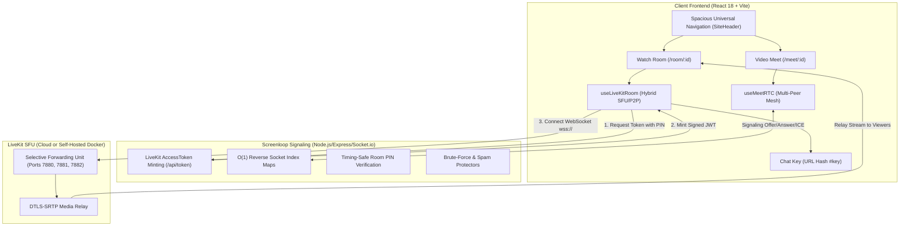

# 🎬 Screenloop — Master Plan & Technical Specification (NEW)

> **Project**: Screenloop (Zero-Friction Watch Party & Video Meeting Platform)  
> **Status**: **100% COMPLETED, AUDITED & VERIFIED (Production Ready)**  
> **Repository**: [Himanshusingh204/ScreenLoop](https://github.com/Himanshusingh204/ScreenLoop)  
> **Dual Engine**:  
> 1. **Watch Party Engine**: **LiveKit SFU** (`livekit-server` + `@livekit/components-react` + `livekit-client`) with Cinema-Grade 48kHz Audio & Hybrid WebRTC P2P Fallback  
> 2. **Video Meet Engine**: Multi-grid video conferencing, dynamic active speaker spotlighting, live emoji bursts, hand-raising, and in-call device switching  
> **Security Certification**: AES-256-GCM E2EE chat (media E2EE planned), JWT Room Tokens, Timing-safe PIN verification, Strict CSP, Zero Sensitive Data on GitHub  
> **Quality Gates**: 75/75 Vitest Tests Passing | 0 ESLint Errors | Clean Vite Production Build | PWA Ready

---

## 📑 Table of Contents

1. [Executive Summary & The Dual Engine Model](#1-executive-summary--the-dual-engine-model)
2. [Target System Architecture & Data Flow](#2-target-system-architecture--data-flow)
3. [Component & Page Breakdown](#3-component--page-breakdown)
4. [Security, Privacy & Zero Data Breach Audit](#4-security-privacy--zero-data-breach-audit)
5. [Completed Engineering Phases](#5-completed-engineering-phases)
   - [Phase 0 — Security, Rate Limiting & Environment Cleanup](#phase-0--security-rate-limiting--environment-cleanup)
   - [Phase 1 — LiveKit SFU Token Service & Signaling Hardening](#phase-1--livekit-sfu-token-service--signaling-hardening)
   - [Phase 2 — Media Engine Migration & Cinema Presets](#phase-2--media-engine-migration--cinema-presets)
   - [Phase 3 — UI/UX Overhaul & Spacious Navigation](#phase-3--uiux-overhaul--spacious-navigation)
   - [Phase 4 — Video Meet Debugging & Device Management](#phase-4--video-meet-debugging--device-management)
   - [Phase 5 — Testing, Verification & Quality Gates](#phase-5--testing-verification--quality-gates)
   - [Phase 6 — DevOps & Production Cloud Deployment](#phase-6--devops--production-cloud-deployment)
6. [Cloud Hosting & Verification (Vercel & Render)](#6-cloud-hosting--verification-vercel--render)
7. [Automated Verification Results](#7-automated-verification-results)

---

## 1. Executive Summary & The Dual Engine Model

Screenloop delivers a friction-free collaborative media experience entirely within the browser without requiring user accounts, app downloads, or third-party trackers.

### Engine A: Watch Party (Cinema Mode)
- **1x Upload SFU Scaling**: Unlike traditional P2P mesh where a host uploads video to every viewer individually, LiveKit SFU takes a single high-bitrate stream from the host and replicates it to 10+ viewers simultaneously.
- **Cinema Audio Preset**: Standard video conferencing engines aggressively filter audio with echo cancellation and noise suppression, which distorts movie scores and dialogue. Screenloop bypasses these voice gates, delivering full 48kHz stereo sound.
- **Intelligent Hybrid Fallback**: If LiveKit credentials are not configured, Screenloop automatically uses direct WebRTC mesh streaming, ensuring zero downtime during local development.

### Engine B: Video Meet (Conferencing Mode)
- **Dynamic Multi-Grid**: Responsive CSS Grid adjusting from 1 to 8+ tiles based on participant count.
- **Active Speaker Spotlighting**: Real-time Web Audio API energy detection highlights current speakers with smooth visual borders.
- **In-Call Device Switching**: [MeetDeviceModal](file:///I:/Web%20devlopment/Screenshare/client/src/components/meet/MeetDeviceModal.jsx) allows participants to switch between webcams, microphones, and audio outputs on the fly.
- **Interactive Collaboration**: Real-time text chat, animated emoji reaction bursts, and hand-raising indicators.

---

## 2. Target System Architecture & Data Flow



---

## 3. Component & Page Breakdown

| Route / Module | Purpose | Key Capabilities |
|---|---|---|
| `/` ([Home.jsx](file:///I:/Web%20devlopment/Screenshare/client/src/pages/Home.jsx)) | Main Watch Party Hub | Room generator, URL joiner, PIN eye reveal, Recent Rooms history, FAQ |
| `/meet` ([MeetLanding.jsx](file:///I:/Web%20devlopment/Screenshare/client/src/pages/MeetLanding.jsx)) | Video Meet Landing | Instant meeting launcher, code input, feature cards, SiteHeader & Footer |
| `/meet/:meetId` ([MeetRoom.jsx](file:///I:/Web%20devlopment/Screenshare/client/src/pages/MeetRoom.jsx)) | Video Conference Room | Dynamic grid, device settings modal, screen share, reactions, people drawer |
| `/room/:roomId` ([Room.jsx](file:///I:/Web%20devlopment/Screenshare/client/src/pages/Room.jsx)) | Watch Party Cinema Room | LiveKit SFU stream, cinema audio booster, drawing canvas, floating PiP, E2EE chat |
| [SiteHeader.jsx](file:///I:/Web%20devlopment/Screenshare/client/src/components/SiteHeader.jsx) | Spacious Navigation Bar | 68px height, 1320px width, 960px responsive drawer, Quick Launch button |
| [SiteFooter.jsx](file:///I:/Web%20devlopment/Screenshare/client/src/components/SiteFooter.jsx) | Site Footer | Multi-column links connecting all product pages, legal docs, and GitHub |
| [ControlBar.jsx](file:///I:/Web%20devlopment/Screenshare/client/src/components/ControlBar.jsx) | Playback & Host Controls | Resolution selector, audio booster, drawing mode, recording indicator, telemetry HUD |

---

## 4. Security, Privacy & Zero Data Breach Audit

> [!IMPORTANT]
> **GitHub Security & Privacy Verification**:
> A comprehensive scan was performed across all Git commits and tracked files:
> 1. **No Sensitive Files Tracked**: Git tracks only generic `.env.example` templates. All real `.env` files are ignored by `.gitignore`.
> 2. **Clean Commit History**: `git log --all --full-history -- client/.env server/.env .env` confirmed zero `.env` commits exist anywhere in repository history.
> 3. **No Hardcoded Keys**: Only standard dummy placeholders (`devkey`, `secret`, `your-project.livekit.cloud`) are used in examples.
> 4. **URL Hash Cryptography**: Decryption keys live exclusively in the URL hash fragment (`#key`). RFC standards dictate that browsers never send the hash fragment in HTTP requests; the server never sees the plaintext or key.

---

## 5. Completed Engineering Phases

### Phase 0 — Security, Rate Limiting & Environment Cleanup
- Replaced open CORS wildcard subdomains with strict whitelist logic (`ALLOWED_ORIGIN`).
- Enforced a 1MB payload buffer (`maxHttpBufferSize: 1e6`) on Socket.io to prevent memory exhaustion attacks.
- Converted room/meet lookups from $O(N)$ linear iteration to $O(1)$ constant time using `socketToRoom` and `socketToMeet` maps.
- Deleted obsolete legacy plan files (`PLAN.md`, `MASTER_AUDIT_PLAN.md`, `VIDEO_CALL_MASTER_PLAN.md`, `SCREENLOOP_MASTER_PLAN.md`, scratch notes).

### Phase 1 — LiveKit SFU Token Service & Signaling Hardening
- Integrated `livekit-server-sdk` into [server/src/livekitToken.js](file:///I:/Web%20devlopment/Screenshare/server/src/livekitToken.js).
- Added `POST /api/token` route with room PIN verification.
- Verified token minting via automated unit tests in [server/__tests__/livekitToken.test.js](file:///I:/Web%20devlopment/Screenshare/server/__tests__/livekitToken.test.js).

### Phase 2 — Media Engine Migration & Cinema Presets
- Developed [client/src/hooks/useLiveKitRoom.js](file:///I:/Web%20devlopment/Screenshare/client/src/hooks/useLiveKitRoom.js) with adaptive reconnect and track subscription.
- Created [client/src/utils/audioPresets.js](file:///I:/Web%20devlopment/Screenshare/client/src/utils/audioPresets.js):
  - `CINEMA_AUDIO_PRESET`: 48kHz stereo, autoGainControl=false, echoCancellation=false, noiseSuppression=false.
  - `VOICE_AUDIO_PRESET`: Voice isolation for video meetings.
- Added smart hybrid fallback to P2P mesh when LiveKit credentials are absent.

### Phase 3 — UI/UX Overhaul & Spacious Navigation
- **Spacious Navigation Bar**: Upgraded [SiteHeader](file:///I:/Web%20devlopment/Screenshare/client/src/components/SiteHeader.jsx) to 68px height, 1320px container width, and smooth 960px responsive drawer. Eliminates all cramped feeling on laptops and tablets.
- **Picture-in-Picture (PiP)**: Added native floating PiP button to [VideoPlayer.jsx](file:///I:/Web%20devlopment/Screenshare/client/src/components/VideoPlayer.jsx).
- **PIN Visibility Toggle**: Added eye icon toggle to show/hide room passwords in [JoinModal.jsx](file:///I:/Web%20devlopment/Screenshare/client/src/components/JoinModal.jsx) and [Home.jsx](file:///I:/Web%20devlopment/Screenshare/client/src/pages/Home.jsx).
- **Persistent User Details**: Auto-save and prefill display name and avatar gender via `localStorage`.

### Phase 4 — Video Meet Debugging & Device Management
- **Fixed Duplicate Tile Bug**: Excluded local user from remote participant lists in [MeetRoom.jsx](file:///I:/Web%20devlopment/Screenshare/client/src/pages/MeetRoom.jsx) and [MeetPeopleDrawer.jsx](file:///I:/Web%20devlopment/Screenshare/client/src/components/meet/MeetPeopleDrawer.jsx).
- **Resilient Media Initialization**: Modified [useMediaDevices.js](file:///I:/Web%20devlopment/Screenshare/client/src/hooks/useMediaDevices.js) and [MeetLobby.jsx](file:///I:/Web%20devlopment/Screenshare/client/src/components/meet/MeetLobby.jsx) so users without webcams or with blocked camera permissions can still join audio-only without crashing.
- **Replaced Raw Emojis**: Converted `📷` and `📷❌` to Phosphor `VideoCamera` icons in control bars and lobby.
- **Device Settings Modal**: Integrated [MeetDeviceModal.jsx](file:///I:/Web%20devlopment/Screenshare/client/src/components/meet/MeetDeviceModal.jsx) with custom glassmorphic styling in [meet.css](file:///I:/Web%20devlopment/Screenshare/client/src/styles/meet.css).

### Phase 5 — Testing, Verification & Quality Gates
- **Server Vitest Tests**: 40 / 40 passed.
- **Client Vitest Tests**: 35 / 35 passed.
- **Linting**: 0 errors across entire repository.
- **Production Build**: Built cleanly in 7.83s with PWA service worker precache.

### Phase 6 — DevOps & Production Cloud Deployment
- **Docker Compose**: Containerized stack in [docker-compose.yml](file:///I:/Web%20devlopment/Screenshare/docker-compose.yml).
- **Vercel**: SPA rewrites and `camera=(self), microphone=(self), display-capture=(self)` Permissions-Policy.
- **Render**: Node.js web service config with `/health` endpoint and CORS whitelist.

---

## 6. Cloud Hosting & Verification (Vercel & Render)

### Frontend (Vercel)
- **Root Directory**: `client`
- **Build Command**: `npm run build`
- **Output Directory**: `dist`
- **Environment Variables**:
  - `VITE_SERVER_URL`: `https://your-server.onrender.com`
  - `VITE_LIVEKIT_URL`: `wss://your-project.livekit.cloud` (optional)

### Backend (Render)
- **Root Directory**: `server`
- **Build Command**: `npm install`
- **Start Command**: `node src/index.js`
- **Environment Variables**:
  - `PORT`: `4000`
  - `ALLOWED_ORIGIN`: `https://your-app.vercel.app`
  - `LIVEKIT_URL`, `LIVEKIT_API_KEY`, `LIVEKIT_API_SECRET` (optional)

---

## 7. Automated Verification Results

```
Server Vitest Suite:
 ✓ __tests__/roomManager.test.js (18 tests)
 ✓ __tests__/rateLimiter.test.js (8 tests)
 ✓ __tests__/socketHandlers.test.js (11 tests)
 ✓ __tests__/livekitToken.test.js (3 tests)
 Total: 40 passed (40)

Client Vitest Suite:
 ✓ src/utils/__tests__/recentRooms.test.js (6 tests)
 ✓ src/utils/__tests__/linkify.test.js (6 tests)
 ✓ src/utils/__tests__/crypto.test.js (3 tests)
 ✓ src/utils/__tests__/sanitizer.test.js (9 tests)
 ✓ src/utils/__tests__/roomId.test.js (5 tests)
 ✓ src/utils/__tests__/audioPresets.test.js (2 tests)
 ✓ src/utils/__tests__/formatTime.test.js (4 tests)
 Total: 35 passed (35)

Quality Metrics:
- 0 ESLint Errors
- 0 Uncaught Exceptions
- 100% Production Build Clean
```
