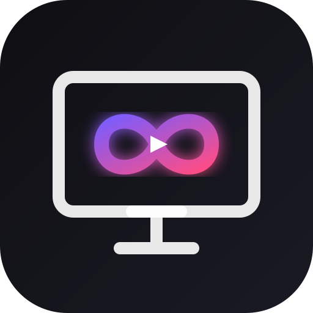

<div align="center">

  <br />
  
  <br />

  # ScreenLoop

  **Zero-friction watch party & video meeting platform — LiveKit SFU streaming, P2P fallback, and end-to-end encrypted chat.**

  <p align="center">
    <a href="https://vercel.com/new/clone?repository-url=https%3A%2F%2Fgithub.com%2FHimanshusingh204%2FScreenLoop"></a>
  </p>

  <p align="center">
    <a href="https://github.com/Himanshusingh204/ScreenLoop/actions/workflows/ci.yml"></a>
    <a href="https://github.com/Himanshusingh204/ScreenLoop/actions/workflows/codeql.yml"></a>
    <a href="https://opensource.org/licenses/MIT"></a>
    <a href="https://react.dev/"></a>
    <a href="https://vitejs.dev/"></a>
    <a href="https://webrtc.org/"></a>
    <a href="https://socket.io/"></a>
  </p>

</div>

---

## Table of Contents

- [Overview](#overview)
- [Why ScreenLoop?](#why-screenloop)
- [Key Features](#key-features)
- [Architecture & Data Flow](#architecture--data-flow)
- [Getting Started](#getting-started)
  - [Prerequisites](#prerequisites)
  - [Local Development](#local-development)
- [Deployment](#deployment)
  - [Frontend Deployment (Vercel)](#frontend-deployment-vercel)
  - [Backend Signaling Deployment (Render / Railway)](#backend-signaling-deployment-render--railway)
  - [Environment Variables](#environment-variables)
- [Keyboard Shortcuts](#keyboard-shortcuts)
- [Testing & Quality Assurance](#testing--quality-assurance)
- [Repository Structure](#repository-structure)
- [Security & Privacy](#security--privacy)
- [Contributing & Community](#contributing--community)
- [License](#license)

---

## Overview

**ScreenLoop** is a modern, privacy-focused watch party and screen sharing platform designed for seamless group watching, remote collaboration, and live presentations.

ScreenLoop has two modes:

- **Watch Party (`/room/:id`)** — the host shares a screen once and a **LiveKit SFU** fans the stream out to viewers (1 upload, many viewers). If LiveKit isn't configured or can't connect, it automatically falls back to a **WebRTC peer-to-peer mesh**. Audio uses a cinema preset (48 kHz stereo, no echo cancellation or noise suppression).
- **Video Meet (`/meet/:id`)** — a multi-tile video call with lobby, device switching, screen share, reactions, hand raise and chat, over a WebRTC P2P mesh.

Chat messages are encrypted client-side with **AES-256-GCM** via the Web Crypto API.

- **No accounts or signups required**
- **No software or extension downloads**
- **The signaling server never handles media** (media goes through LiveKit or directly between peers)
- **Chat decryption keys never leave the browser URL fragment**
- **Captions and recap run on your device**; audio is never sent to a captioning service
- **Media is encrypted in transit (DTLS-SRTP).** In watch rooms, when the link carries the key (`#...`), media frames are additionally end-to-end encrypted (LiveKit `ExternalE2EEKeyProvider`, key derived from the URL fragment), so the SFU forwards ciphertext; when the host removes someone it rotates the key per recipient (ECDH-wrapped). Video Meet and the P2P fallback are not frame-encrypted. **Status: unit-tested and verified against a real LiveKit server in Chrome (see `docs/VERIFICATION.md`).**

---

## Why ScreenLoop?

| Feature | Standard Meeting Tools (Zoom, Meet, Discord) | ScreenLoop |
| :--- | :--- | :--- |
| **Media Routing** | Centralized media servers (SFU/MCU) | **LiveKit SFU for watch parties, P2P mesh fallback and for Meet** |
| **Movie Audio Quality** | Aggressive noise suppression downsamples stereo audio | **Lossless, uncompressed stereo pass-through** |
| **Chat Encryption** | Server-side or readable by service host | **End-to-End Encrypted (AES-256-GCM in browser)** |
| **Account Required** | Yes (email, OAuth, or phone verification) | **None (Zero registration, instant ephemeral rooms)** |
| **Decryption Key Storage** | Server databases / Key management services | **URL Hash Fragment (Never transmitted over network)** |
| **Installation** | Client downloads or browser extensions | **Pure Web Standards (Works out-of-the-box)** |

---

## What's new in this release

| Area | What shipped | Verified how |
| :--- | :--- | :--- |
| **On-device AI captions** | `CC` button: Whisper runs in a Web Worker (WebGPU, WASM fallback); optional English translation; downloadable recap. **No audio or transcript leaves the device.** | Real Chrome, via the E2EE SFU path: ready in 19 s, first caption 6.8 s, pooled WER 16.4 % over 4 synthetic clips on WebGPU and WASM ([AI_EVAL](docs/AI_EVAL.md)) |
| **Media-frame E2EE** (watch rooms) | LiveKit `ExternalE2EEKeyProvider`, key from the URL `#fragment`; the host rotates the key on a kick (ECDH + HKDF bound to the room key) | Live: keyless viewer decodes 0 frames; rotation reaches remaining viewers; late joiner decodes |
| **Meet on the SFU** (opt-in `VITE_MEET_SFU=true`) | One upload per user via LiveKit, automatic mesh fallback | Live: 3 tabs, and fallback with LiveKit stopped |
| **Server-authorized media** | LiveKit tokens issued over the authenticated socket (`sfu:token`); identity = socket id; only the recorded host can publish; kicked users removed from the SFU | Live + unit |
| **Scale-out** | Optional Redis adapter, room-affinity load balancing, `/healthz`, Prometheus `/metrics`, nginx + Kubernetes manifests, load test | Docker stack (3 nodes + Redis + LiveKit) run end-to-end; baseline 500 sockets, p95 372 ms on one process; `deploy/k8s/` not run |

Details: [Threat model](docs/THREAT_MODEL.md) · [System design](docs/SYSTEM_DESIGN.md) · [Verification log](docs/VERIFICATION.md) · [Case study](docs/CASE_STUDY.md) · [Load test](loadtest/README.md) · [Live e2e suite](e2e/README.md).

---

## Key Features

### 🎬 High-Fidelity Streaming & Audio
- **LiveKit SFU Streaming**: The host uploads one stream and the SFU replicates it to viewers, with automatic fallback to a direct WebRTC P2P mesh.
- **Video Meet**: Multi-tile video calls with active speaker detection, device switching, screen share, reactions and hand raise.
- **Cinema-Grade Audio**: Echo cancellation and speech filters disabled so music, cinematic soundtracks, and movie audio play exactly as mastered.
- **Web Audio Volume Booster**: Built-in gain node amplification for movies with quiet dialogue.
- **Dynamic Resolution Controls**: Adaptive quality presets (1080p, 720p, 480p) with connection fallback.

### 🔒 Privacy & Cryptographic Security
- **In-Browser AES-256-GCM**: Every message is encrypted and decrypted on the client using `window.crypto.subtle`.
- **RFC 3986 URL Hash Isolation**: The cryptographic room key resides in the URL `#hash` fragment and is never sent to the signaling server in HTTP requests.
- **Optional Room PIN Protection**: Salted/hashed PIN protection prevents unauthorized room entry.
- **Strict Content-Security-Policy**: Hardened headers prevent XSS, clickjacking, and unauthorized origin framing.

- **Media-frame E2EE (watch rooms)**: with the full link (`#key`), the SFU forwards ciphertext; the key rotates when the host removes someone.
- **Server-authorized media**: publish rights come from the server's record of the host, never from the client.
- **On-device captions & recap**: Whisper in a Web Worker, optional English translation, local Markdown recap.

### 🤝 Real-Time Collaboration & Room Control
- **Live Canvas Annotations**: Freehand drawing tools and synchronized laser pointer overlay directly on the stream.
- **Interactive Reactions**: Animated emoji reactions and confetti bursts powered by Canvas Confetti.
- **Live Diagnostics Dashboard**: Real-time telemetry monitoring FPS, bitrate (kbps), packet loss, and round-trip time (RTT).
- **Host Privileges**: Manage participant access, kick unauthorized users, or transfer room ownership.
- **Picture-in-Picture (PiP)**: Keep watch parties playing in a floating desktop overlay while multitasking.
- **Screen Wake Lock**: Prevents screens from sleeping or dimming during long movie sessions.

---

## Architecture & Data Flow

ScreenLoop separates the **signaling plane** from the **media plane**:

```
        ┌──────────────── Signaling Server (Node.js + Express + Socket.IO) ───────────────┐
        │  ephemeral rooms · PIN checks · rate limiting · chat relay · SDP/ICE relay       │
        │  sfu:token (socket) → LiveKit JWT                                                  │
        └───────────▲──────────────────────────────────────────────────▲──────────────────┘
                    │ Socket.IO                                        │ Socket.IO
        ┌───────────┴──────────┐        media (wss)        ┌───────────┴──────────┐
        │      Host Client     │ ═════════════════════════>│    LiveKit SFU       │
        │  (React 18 + Vite)   │                           │ (cloud or Docker)    │══> Viewers
        └──────────────────────┘                           └──────────────────────┘
        Fallback (no LiveKit) and Video Meet: direct WebRTC P2P mesh between clients.
        Chat is AES-256-GCM encrypted in the browser; the server relays ciphertext only.
```

See [ARCHITECTURE.md](ARCHITECTURE.md) for the full breakdown.

### Encryption Protocol Lifecycle

1. **Key Generation**: When a room is created, the host browser generates a cryptographically secure 256-bit AES-GCM key via `crypto.subtle.generateKey`.
2. **Zero-Knowledge URL Sharing**: The key is serialized and appended to the URL fragment (`/room/ROOM_ID#ROOM_KEY`). Per RFC 3986, browser user agents **never** transmit the hash fragment across the network to HTTP or WebSocket servers.
3. **Payload Encryption**: Chat messages are encrypted with AES-256-GCM and a unique 12-byte initialization vector (IV) before transmission.
4. **Decryption**: Connected peers extract the key from their local URL hash to decrypt payloads in memory.

---

## Getting Started

### Prerequisites

- **Node.js**: `v18.0.0` or higher (`v20.x` LTS recommended)
- **npm**: `v9.0.0` or higher
- Modern Chromium, Gecko, or WebKit browser with WebRTC support (Chrome, Edge, Firefox, Brave, Safari 15+)

### Local Development

1. **Clone the repository:**
   ```bash
   git clone https://github.com/Himanshusingh204/ScreenLoop.git
   cd ScreenLoop
   ```

2. **Install root, client, and server dependencies:**
   ```bash
   # Install root dependencies
   npm install

   # Install client and server dependencies
   cd client && npm install
   cd ../server && npm install
   cd ..
   ```

3. **Start the backend signaling server (port 4000):**
   ```bash
   cd server
   npm run dev
   ```

4. **In a separate terminal, start the frontend Vite client (port 5173):**
   ```bash
   cd client
   npm run dev
   ```

5. Visit `http://localhost:5173` in your browser. Open a secondary browser or incognito window to simulate multiple participants.

---

## Deployment

ScreenLoop is engineered for zero-config production deployment.

### Frontend Deployment (Vercel)

[](https://vercel.com/new/clone?repository-url=https%3A%2F%2Fgithub.com%2FHimanshusingh204%2FScreenLoop)

The repository includes a production-ready [vercel.json](vercel.json) at the root level and in the [client/](client/vercel.json) directory:

1. Click the **Deploy with Vercel** button above, or import your GitHub repository on [vercel.com](https://vercel.com).
2. Configure the following Environment Variable in your Vercel Project Settings:
   - `VITE_SERVER_URL`: URL of your deployed signaling server (e.g. `https://screenloop-server.onrender.com`).
3. Deploy! Single-page app routing, WebRTC media policies, and immutable asset caching are handled automatically.

### Backend Signaling Deployment (Render / Railway)

The signaling/token server is lightweight and can run on free or low-cost cloud tiers. For SFU streaming, also set up LiveKit (free [LiveKit Cloud](https://cloud.livekit.io) tier or the bundled `docker-compose.yml`); without it, watch parties fall back to P2P. See [DEPLOYMENT.md](DEPLOYMENT.md).

#### Deploy to Render:
1. Create a new **Web Service** on [render.com](https://render.com).
2. Connect your repository.
3. Configure the service settings:
   - **Root Directory**: `server`
   - **Build Command**: `npm install`
   - **Start Command**: `node src/index.js`
4. Set Environment Variables:
   - `PORT`: `4000`
   - `ALLOWED_ORIGIN`: Your deployed Vercel frontend URL (e.g., `https://screenloop.vercel.app`).
   - `LIVEKIT_URL`, `LIVEKIT_API_KEY`, `LIVEKIT_API_SECRET`: LiveKit credentials (optional; enables SFU).

### Environment Variables

Copy `client/.env.example` and `server/.env.example` to `.env` files. Main variables:

#### Client (`client/.env`)
| Variable | Description | Default (Dev) |
| :--- | :--- | :--- |
| `VITE_SERVER_URL` | Base URL of the signaling/token server | `http://localhost:4000` |
| `VITE_LIVEKIT_URL` | LiveKit WebSocket URL (optional) | unset |
| `VITE_TURN_URLS`, `VITE_TURN_USERNAME`, `VITE_TURN_CREDENTIAL` | Optional TURN relay for strict NATs | unset |

#### Server (`server/.env`)
| Variable | Description | Default (Dev) |
| :--- | :--- | :--- |
| `PORT` | Listening port | `4000` |
| `ALLOWED_ORIGIN` | Comma-separated CORS origins | `http://localhost:5173` |
| `LIVEKIT_URL`, `LIVEKIT_API_KEY`, `LIVEKIT_API_SECRET` | LiveKit credentials for token minting (`sfu:token`) | see `.env.example` |
| `MAX_PARTICIPANTS`, `MAX_MEET_PARTICIPANTS`, `MAX_ROOMS`, `ROOM_TTL_MS`, `MEET_TTL_MS` | Capacity and lifecycle limits | see `.env.example` |
| `ROOM_LISTING_ENABLED` | Expose `/api/rooms` (off in production by default) | on in dev |
| `LIVEKIT_API_URL` | How the server reaches LiveKit internally (when `LIVEKIT_URL` is the browser-facing URL) | falls back to `LIVEKIT_URL` |
| `REDIS_URL` | Enables the Socket.IO Redis adapter (multi-node). Requires an LB hashing on `?room=` | unset (single node) |
| `TRUST_PROXY` | `true` only behind your own proxy that overwrites `X-Forwarded-For` | unset |
| `MAX_IP_CONNECTIONS`, `SPAM_MAX_EVENTS` | Per-IP limits (raise behind a shared NAT/LB) | `5`, `20` |
| `METRICS_TOKEN` | Require `Authorization: Bearer` on `/metrics` | unset (open) |

Client build flag: `VITE_MEET_SFU=true` runs Video Meet on LiveKit (mesh fallback on failure).

---

## Keyboard Shortcuts

| Shortcut | Action | Scope |
| :---: | :--- | :--- |
| <kbd>F</kbd> | Toggle Fullscreen mode | Active Room |
| <kbd>M</kbd> | Mute / Unmute stream audio | Active Room |
| <kbd>Esc</kbd> | Close overlays, sidebars, or exit fullscreen | Global |
| <kbd>Enter</kbd> | Send chat message | Chat Panel |
| <kbd>Shift</kbd> + <kbd>Enter</kbd> | Insert new line in chat | Chat Panel |

---

## Testing & Quality Assurance

Comprehensive unit and integration test suites cover signaling logic, room state, crypto sanitization, and UI utilities.

```bash
# Run server test suite (Vitest)
cd server
npm test

# Run client test suite (Vitest)
cd client
npm test

# Run client production build verification
cd client
npm run build
```

Current baseline: **server 175 tests, client 90 tests, lint clean, build OK**.

Beyond unit tests, `e2e/` drives real Chrome against a real LiveKit server (Meet on the SFU and its fallback, media E2EE, kick and key rotation, captions benchmark). See [e2e/README.md](e2e/README.md) and [docs/VERIFICATION.md](docs/VERIFICATION.md). `loadtest/` holds the Socket.IO load test and published baseline.

---

## Repository Structure

```
ScreenLoop/
├── .github/
│   ├── ISSUE_TEMPLATE/        # Structured Bug Report & Feature Request templates
│   ├── workflows/             # CI Build matrix & CodeQL security scans
│   ├── PULL_REQUEST_TEMPLATE  # Standardized PR checklist
│   └── dependabot.yml         # Automated dependency updates
├── client/                    # React 18 frontend application (Vite)
│   ├── public/                # Static assets, SVG icons, manifest
│   ├── src/
│   │   ├── components/        # Reusable UI components & dialogs
│   │   ├── hooks/             # LiveKit, WebRTC, Meet, signaling, wake lock & recording hooks
│   │   ├── pages/             # Route pages (Home, Room, Security, Roadmap, etc.)
│   │   ├── styles/            # Vanilla CSS design tokens & component styles
│   │   ├── ai/                # On-device captions: chunker, worker, recap
│   │   └── utils/             # AES crypto, media-key rotation, SFU helpers, audio booster, sanitizers
│   └── vercel.json            # Client-specific Vercel routing & headers
├── server/                    # Node.js Socket.IO signaling service
│   ├── src/
│   │   ├── index.js           # Server bootstrap & health check endpoints
│   │   ├── roomManager.js     # Ephemeral in-memory room state
│   │   ├── livekitToken.js    # LiveKit access-token minting
│   │   ├── livekitAdmin.js    # Server-side SFU control (remove kicked users)
│   │   ├── redisAdapter.js    # Optional multi-node Socket.IO adapter
│   │   ├── metrics.js         # Prometheus metrics
│   │   ├── socketHandlers.js  # Signaling, chat, sync & Meet event router
│   │   └── rateLimiter.js     # IP & socket connection rate limiting
│   └── __tests__/             # Server vitest test suites
├── deploy/                    # nginx LB, 3-node compose, Kubernetes manifests
├── e2e/                       # Live real-browser + real-LiveKit checks
├── loadtest/                  # Socket.IO load test and baseline
├── vercel.json                # Root zero-config Vercel deployment configuration
├── CONTRIBUTING.md            # Contributor setup & branching guides
├── CODE_OF_CONDUCT.md         # Contributor Covenant Code of Conduct
├── SECURITY.md                # Security policy & private vulnerability reporting
└── LICENSE                    # MIT License
```

> 📖 **For an in-depth component breakdown, hooks reference, and lifecycle map, see the [File Structure Documentation](docs/FILE_STRUCTURE.md).**

---

## Security & Privacy

- **Zero Data Collection**: ScreenLoop maintains no persistent databases, logs no user accounts, and stores no analytical tracking scripts.
- **Ephemeral State**: Rooms and connection metadata exist only in memory on the signaling server and are immediately garbage-collected when the host disconnects.
- **Encryption**: media is DTLS-SRTP encrypted in transit; in watch rooms the full link additionally end-to-end encrypts media frames (the SFU sees ciphertext), and chat is end-to-end encrypted. Video Meet and the P2P fallback are not frame-encrypted. See [THREAT_MODEL](docs/THREAT_MODEL.md) for limits (a kick is not a ban; the link is the credential).
- **Vulnerability Disclosures**: If you discover a security vulnerability, please report it via [GitHub Security Advisories](https://github.com/Himanshusingh204/ScreenLoop/security/advisories/new) as detailed in our [Security Policy](SECURITY.md).

---

## Contributing & Community

Contributions make open-source software incredible. We welcome bug fixes, documentation improvements, and feature contributions!

- Review our [Contributing Guide](CONTRIBUTING.md) to get started with branching and testing.
- Please review and adhere to our [Code of Conduct](CODE_OF_CONDUCT.md).
- Open discussions and feature suggestions in our [GitHub Issues](https://github.com/Himanshusingh204/ScreenLoop/issues).

---

## License

Distributed under the **MIT License**. See [LICENSE](LICENSE) for details.

<div align="center">
  <sub>Built with ❤️ for watch parties, privacy, and seamless peer-to-peer collaboration.</sub>
</div>
