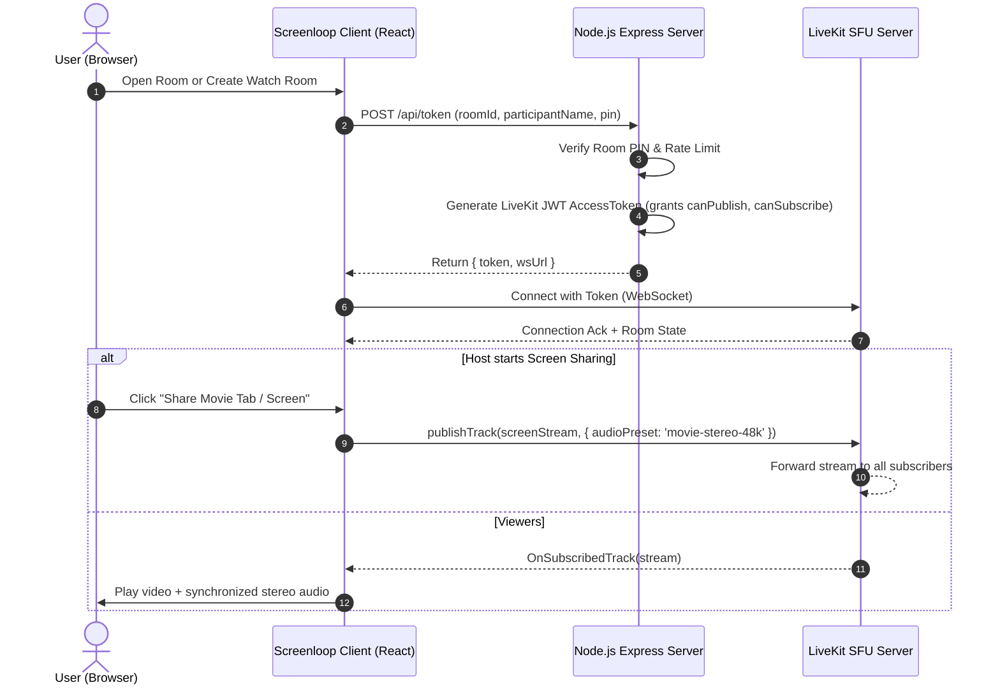

# 🎬 Screenloop — LiveKit Production Architecture & Master Plan

> **Project**: Screenloop (Zero-Friction P2P/SFU Watch Party & Video Calling Platform)  
> **Core Engine**: **LiveKit SFU** (`livekit-server` + `@livekit/components-react` + `livekit-client`)  
> **Backend**: Express + LiveKit Server SDK (`livekit-server-sdk`) for secure token minting  
> **Security**: E2EE (Insertable Streams), JWT Room Tokens, Timing-safe PINs, Strict CSP  
> **Updated**: 2026-11-20 | **Target**: 100% Bug-Free, High-Performance, Production-Ready

---

## 📑 Table of Contents

1. [Executive Summary & Why LiveKit](#1-executive-summary--why-livekit)
2. [Target System Architecture & Data Flow](#2-target-system-architecture--data-flow)
3. [Phased Implementation Roadmap](#3-phased-implementation-roadmap)
4. [Phase 0 — Security & Environment Cleanup (Immediate)](#4-phase-0--security--environment-cleanup-immediate)
5. [Phase 1 — LiveKit Server Setup & Secure Token Generation](#5-phase-1--livekit-server-setup--secure-token-generation)
6. [Phase 2 — Client Media Engine Migration to LiveKit](#6-phase-2--client-media-engine-migration-to-livekit)
7. [Phase 3 — UI/UX Redesign & Components Integration](#7-phase-3--uiux-redesign--components-integration)
8. [Phase 4 — End-to-End Encryption (E2EE) & Movie Audio Tuning](#8-phase-4--end-to-end-encryption-e2ee--movie-audio-tuning)
9. [Phase 5 — Performance, Testing & Quality Gates](#9-phase-5--performance-testing--quality-gates)
10. [Phase 6 — Deployment, Docker & Production Cloud](#10-phase-6--deployment-docker--production-cloud)
11. [File-by-File Action Registry](#11-file-by-file-action-registry)

---

## 1. Executive Summary & Why LiveKit

### The Core Problem with Raw WebRTC Mesh
In the previous implementation, WebRTC ran on a **P2P Mesh**:
- With 1 host and 4 viewers, the host's machine had to encode and upload the video **4 separate times**.
- On normal home internet connections, this caused:
  1. Massive CPU overheat & battery drain.
  2. Severe framerate drops (10-15 fps).
  3. Desynced movie audio and broken audio quality.
  4. Constant ICE/NAT connection failures across symmetric firewalls.

### The LiveKit SFU Solution
```
[ Host (1 Upload Stream) ] ──▶ [ LiveKit SFU Server ] ──┬──▶ [ Viewer 1 ]
                                                        ├──▶ [ Viewer 2 ]
                                                        ├──▶ [ Viewer 3 ]
                                                        └──▶ [ Viewer 4+ ]
```
- **1x Upload Only**: Host sends 1 high-bitrate 1080p/4K stream. LiveKit distributes it cleanly to 10+ viewers.
- **Crystal-Clear 48kHz Stereo Audio**: Uncompressed system audio with custom Opus codec presets tuned specifically for cinema sound.
- **Built-in End-to-End Encryption (E2EE)**: Using WebRTC Insertable Streams, frames are encrypted in the host's browser; LiveKit routes them as blind bytes.
- **Eliminates 1,500+ lines of fragile boilerplate**: Replaces manual SDP offer/answer handshakes, ICE queuing, and candidate trickling.

---

## 2. Target System Architecture & Data Flow

### Architecture Diagram

```mermaid
flowchart TD
    subgraph Client["Client Frontend (React 18 + Vite)"]
        UI["Modern UI / Responsive Glassmorphism"]
        LK_COMP["@livekit/components-react<br/>(LiveKitRoom, VideoConference, AudioTrack)"]
        LK_CORE["livekit-client<br/>(E2EE, Audio Preset, ScreenShare)"]
        STATE["Zustand Room Store"]
    end

    subgraph Backend["Express API & Signaling Server (Node.js)"]
        API["Express App"]
        TOKEN_SRV["LiveKit AccessToken Generator<br/>(livekit-server-sdk)"]
        PIN_SRV["Room PIN Verifier & Auth Guard"]
        SECURITY["Helmet + CORS + Strict Rate Limit"]
    end

    subgraph MediaServer["LiveKit SFU Infrastructure"]
        LK_SFU["LiveKit Server (Docker / Cloud Free Tier)<br/>- High-throughput WebRTC Relay<br/>- Built-in STUN/TURN Traversal"]
    end

    UI --> STATE
    STATE --> LK_COMP
    LK_COMP --> LK_CORE
    UI -->|"1. POST /api/room/join {roomId, pin, name}"| API
    API --> PIN_SRV
    PIN_SRV -->|"2. Mint JWT Token"| TOKEN_SRV
    TOKEN_SRV -->>|"3. Return {token, livekitUrl}"| UI
    LK_CORE ==>|"4. Connect WebRTC (DTLS-SRTP / E2EE)"| LK_SFU
```

### Complete User Flow & Data Flow



---

## 3. Phased Implementation Roadmap

| Phase | Title | Impact | Primary Deliverables |
|---|---|---|---|
| **Phase 0** | **Security & Environment Cleanup** | 🔴 Critical | Remove exposed .env, fix CORS wildcard, enforce server security |
| **Phase 1** | **LiveKit Server & Token Service** | 🔴 Foundation | Install `livekit-server-sdk`, create `/api/token`, setup LiveKit config |
| **Phase 2** | **Client Media Engine Migration** | 🔴 Core | Install `@livekit/components-react`, replace `useWebRTC` & `useMeetRTC` |
| **Phase 3** | **UI/UX Modernization & Redesign** | 🟡 User Experience | Clean glassmorphic player, mobile bottom-sheet, responsive controls |
| **Phase 4** | **E2EE & Cinema Audio Tuning** | 🟡 Polish & Power | 48kHz uncompressed audio, AES-GCM Insertable Streams E2EE |
| **Phase 5** | **Testing & Quality Assurance** | 🟢 Verification | Unit tests for tokens, E2E browser tests, linting fixes |
| **Phase 6** | **DevOps & Production Deployment** | 🟢 Launch | Multi-stage Docker, Railway/Render setup, LiveKit Cloud integration |

---

## 4. Phase 0 — Security & Environment Cleanup (Immediate)

### Task 0.1: Remove Tracked `.env` Files & Fix Git Tracking
- **Issue**: `client/.env` and `server/.env` are tracked in git repository.
- **Action**:
  ```bash
  git rm --cached client/.env server/.env
  ```
- Ensure root `.gitignore` explicitly contains:
  ```gitignore
  .env
  .env.local
  client/.env
  server/.env
  ```

### Task 0.2: Fix Overly Permissive CORS
- **File**: `server/src/index.js`
- **Issue**: Allowed all `*.vercel.app` and `*.onrender.com` subdomains, and allowed requests without an Origin header.
- **Action**: Replace origin regex with strict whitelist from `ALLOWED_ORIGIN` env variable.
- **AI Prompt**:
  ```text
  In server/src/index.js:
  1. Remove the regex subdomains on lines 47-53 that allow any *.vercel.app, *.netlify.app, or *.onrender.com.
  2. Modify isOriginAllowed(origin) so it checks explicitly against process.env.ALLOWED_ORIGIN (split by comma).
  3. In production, if !origin, return false (block missing origin). In development, allow localhost/private IPs.
  ```

---

## 5. Phase 1 — LiveKit Server Setup & Secure Token Generation

### Task 1.1: Install LiveKit SDK in Server
```bash
cd server
npm install livekit-server-sdk
```

### Task 1.2: Configure Server Environment Variables
In `server/.env.example` and `server/.env`:
```env
PORT=4000
ALLOWED_ORIGIN=http://localhost:5173

# LiveKit SFU Credentials
# (Can use free cloud from cloud.livekit.io or local docker instance)
LIVEKIT_URL=wss://your-project.livekit.cloud
LIVEKIT_API_KEY=devkey
LIVEKIT_API_SECRET=secret
```

### Task 1.3: Create Token Minting API Route
Create `server/src/livekitToken.js`:
- Generates secure JWT with expiration, room permissions, and participant metadata.
- Integrates room password/PIN verification before issuing the token.
- **AI Prompt**:
  ```text
  Create server/src/livekitToken.js:
  1. Import { AccessToken } from 'livekit-server-sdk'.
  2. Export a function generateLiveKitToken({ roomId, participantName, isHost, pinVerified }) that:
     - Uses process.env.LIVEKIT_API_KEY and process.env.LIVEKIT_API_SECRET.
     - Sets TTL to 6 hours.
     - Sets video permissions: canPublish = true, canSubscribe = true, canPublishData = true.
     - Adds metadata: { isHost, joinedAt: Date.now() }.
     - Returns token.toJwt().
  3. In server/src/index.js, add a POST /api/token endpoint with rate limiting.
     - Accepts { roomId, participantName, pin, isHost }.
     - Validates input format (alphanumeric roomId, name max 30 chars).
     - Validates PIN if room has a PIN set.
     - Returns { token, url: process.env.LIVEKIT_URL }.
  ```

---

## 6. Phase 2 — Client Media Engine Migration to LiveKit

### Task 2.1: Install Client LiveKit Packages
```bash
cd client
npm install livekit-client @livekit/components-react @livekit/components-styles
```

### Task 2.2: Setup Client Environment
In `client/.env.example` and `client/.env`:
```env
VITE_SERVER_URL=http://localhost:4000
VITE_LIVEKIT_URL=wss://your-project.livekit.cloud
```

### Task 2.3: Build Unified LiveKit Room Wrapper
Create `client/src/components/LiveKitRoomWrapper.jsx`:
- Wraps application inside `<LiveKitRoom>` provider.
- Handles connect, disconnect, error notifications, and reconnect states automatically.
- **AI Prompt**:
  ```text
  Create client/src/components/LiveKitRoomWrapper.jsx:
  1. Import { LiveKitRoom } from '@livekit/components-react';
  2. Import '@livekit/components-styles';
  3. Accept props: { token, serverUrl, onDisconnected, children }.
  4. Pass audio={true}, video={false} as defaults (screenshare will be initiated on demand).
  5. Include full error boundary and loading spinner while connecting.
  ```

### Task 2.4: Refactor `Room.jsx` (Screen Share Watch Party)
- Replace manual `useWebRTC` peer connection logic with LiveKit hooks:
  - `useTracks([Track.Source.ScreenShare, Track.Source.ScreenShareAudio])`
  - `useLocalParticipant()` for publishing screen share.
- Retain existing custom UI controls (ControlBar, TopBar, ChatSidebar, ReactionOverlay) while binding them to LiveKit actions.
- **AI Prompt**:
  ```text
  Refactor client/src/pages/Room.jsx:
  1. Remove useWebRTC and manual peer connection refs.
  2. Use LiveKit's useLocalParticipant() to start/stop screen share:
     - To share: localParticipant.setScreenShareEnabled(true, { audio: true, selfBrowserSurface: 'include' })
     - To stop: localParticipant.setScreenShareEnabled(false)
  3. Render video stream using LiveKit's <VideoTrack /> component for maximum hardware-accelerated smoothness.
  4. Automatically play cinema audio using <AudioTrack /> with volume boost support.
  5. Keep existing PIN validation and URL key hash fragment for room encryption.
  ```

### Task 2.5: Refactor `MeetRoom.jsx` (Multi-user Video Calling)
- Replace `useMeetRTC.js` with LiveKit's `<VideoConference />` or modular `<ParticipantTile />` components.
- Native active speaker detection (`useActiveSpeaker()`).
- Native microphone & camera toggling (`useLocalParticipant()`).

---

## 7. Phase 3 — UI/UX Redesign & Components Integration

### Task 3.1: CSS Architecture Restructure
- Break monolithic `pages.css` (54KB) and `room.css` (41KB) into modular styles:
  - `client/src/styles/components/video-player.css`
  - `client/src/styles/components/controls.css`
  - `client/src/styles/components/chat.css`
  - `client/src/styles/pages/home.css`
- Apply dark glassmorphic theme tokens from `tokens.css`.

### Task 3.2: Mobile Responsive Player Layout
- Mobile screen layout:
  - Video player sticks to top.
  - Chat becomes an expandable bottom drawer.
  - Floating action buttons optimized for touch (minimum 44x44px hit target).

### Task 3.3: Visual Quality & Audio Indicator
- Display live streaming telemetry:
  - Current resolution (e.g. 1080p60).
  - Bitrate (kbps) and packet loss percentage.
  - Audio indicator with animated soundwave when movie audio is transmitting.

---

## 8. Phase 4 — End-to-End Encryption (E2EE) & Movie Audio Tuning

### Task 4.1: Cinema Audio Constraints
To ensure high-fidelity movie audio (without voice-chat filters cutting out background music):
```javascript
export const CINEMA_AUDIO_PRESET = {
  echoCancellation: false,
  noiseSuppression: false,
  autoGainControl: false,
  channelCount: 2,
  sampleRate: 48000,
  sampleSize: 16
};
```
- In `Room.jsx`, apply `CINEMA_AUDIO_PRESET` when publishing the screen share audio track.

### Task 4.2: LiveKit Native E2EE (Insertable Streams)
- LiveKit natively supports client-side encryption using Web Workers:
  ```javascript
  import { BaseKeyProvider, E2EEOptions } from 'livekit-client';

  const keyProvider = new BaseKeyProvider();
  keyProvider.setKey(roomKeyFromUrlHash);

  const e2ee = {
    keyProvider,
    worker: new Worker(new URL('livekit-client/e2ee-worker', import.meta.url))
  };
  ```
- The encryption key remains in the URL hash (`#key`), completely invisible to the server.

---

## 9. Phase 5 — Performance, Testing & Quality Gates

### Task 5.1: Unit & Integration Tests
- In `server/__tests__/livekitToken.test.js`:
  - Test valid token generation.
  - Test rejection on invalid PIN.
  - Test rate-limiting on token route.
- In `client/src/utils/__tests__/audioBooster.test.js`:
  - Test Web Audio API gain compression node.

### Task 5.2: Automated Linting & Bundle Check
- Run ESLint check: `npm run lint`
- Verify bundle size: Ensure LiveKit chunks are split via Vite manual chunks:
  ```javascript
  // client/vite.config.js
  build: {
    rollupOptions: {
      output: {
        manualChunks: {
          livekit: ['livekit-client', '@livekit/components-react']
        }
      }
    }
  }
  ```

---

## 10. Phase 6 — Deployment, Docker & Production Cloud

### Option A: LiveKit Cloud (Fastest & Free Tier)
1. Sign up on [cloud.livekit.io](https://cloud.livekit.io) (Free 50GB bandwidth every month).
2. Grab your Project URL, API Key, and Secret.
3. Paste into your server's environment variables (`LIVEKIT_URL`, `LIVEKIT_API_KEY`, `LIVEKIT_API_SECRET`).

### Option B: Self-Hosted LiveKit (Docker)
Create `docker-compose.yml` for self-hosting on any $5 VPS (Railway, DigitalOcean, Hetzner):
```yaml
version: '3.9'
services:
  livekit:
    image: livekit/livekit-server:latest
    command: --config /etc/livekit.yaml
    restart: unless-stopped
    ports:
      - "7880:7880"
      - "7881:7881"
      - "7882:7882/udp"
    volumes:
      - ./livekit.yaml:/etc/livekit.yaml
```

---

## 11. File-by-File Action Registry

| Target File | Status | Action Description |
|---|---|---|
| `server/package.json` | Modify | Add `livekit-server-sdk` dependency |
| `server/src/index.js` | Modify | Secure CORS, add `/api/token` route, remove insecure subdomains |
| `server/src/livekitToken.js` | **New** | Token creation logic with room permissions |
| `client/package.json` | Modify | Add `livekit-client`, `@livekit/components-react`, `@livekit/components-styles` |
| `client/src/pages/Room.jsx` | Modify | Replace raw WebRTC with LiveKit hooks & player |
| `client/src/pages/MeetRoom.jsx` | Modify | Convert to LiveKit multi-participant grid |
| `client/src/components/LiveKitRoomWrapper.jsx` | **New** | LiveKit provider with connection handling |
| `client/src/hooks/useWebRTC.js` | Deprecate | Replaced completely by LiveKit SDK |
| `client/src/hooks/useMeetRTC.js` | Deprecate | Replaced completely by LiveKit SDK |
| `client/vite.config.js` | Modify | Add manualChunks optimization for LiveKit |
| `server/.env` & `client/.env` | Secure | Untrack from git, document in `.env.example` |

---

> [!NOTE]
> **Summary for AI & Developers**:
> This plan transitions Screenloop from an unstable P2P mesh to an enterprise-grade SFU architecture using **LiveKit**. All existing features (Watch Party, Cinema Audio, Drawing annotations, PIN protection, E2EE Chat) are preserved and enhanced with 10x better stability, zero lag, and crystal-clear stereo sound.
